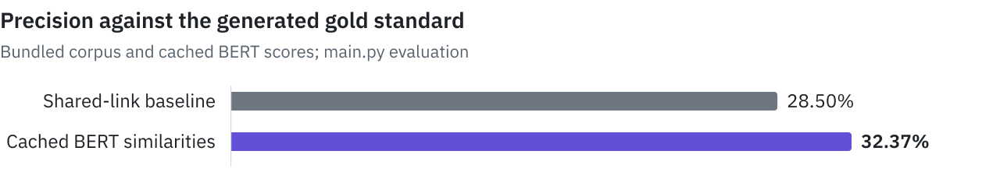

# Wikipedia Similarity

A 2024 third-year computer science project for the language technology course at Université Caen Normandie. It compares Wikipedia biographies using shared links and cached BERT similarities against a reference derived from structured JSON attributes.

<picture>
  <source media="(prefers-color-scheme: dark)" srcset=".github/assets/precision-dark.svg">
  
</picture>

## Results

A local run of `main.py` on the bundled corpus produced the following global metrics. VP, FP and FN are the program's labels for true positives, false positives and false negatives.

| Approach | Precision | VP | FP | FN |
|---|---:|---:|---:|---:|
| Shared-link baseline | 28.50% | 177 | 444 | 444 |
| Cached BERT similarities | 32.37% | 201 | 420 | 420 |

The corpus contains 97 biographies and 4,656 cached pairs. The generated reference labels 13.34% of pairs as similar; each approach selects a matching proportion of its highest-scoring pairs.

## Getting started

Requires Python 3 and Matplotlib. From the repository root, using a Python environment of your choice:

```bash
python -m pip install matplotlib
cd dph_langue/projet
python -u -X utf8 main.py
python -u -X utf8 main.py -s
```

The second run also opens a chart of the overlap between the approaches' VP, FP and FN sets. Evaluation uses local files and cached scores, so it does not require Wikipedia access or a BERT download. It rewrites the intersection reports in `intel/AnalyseStats/`.

## How it works

`gold/Gold.py` derives a threshold from JSON attribute similarities. `naive/NaiveCompare.py` ranks link-set Jaccard similarities. `intel/intelligente.py` loads `intel/pre_calcule_similaritiesV2.json`; `intel/BertSearch.py` contains the separate BERT score-generation code. The French report is in `dph_langue/rapport/`.

## Limitations

The reference is generated heuristically, rather than annotated by people. Pair keys preserve file order instead of normalizing it, so the evaluation can depend on directory enumeration order. The default evaluation uses cached BERT scores, not the earlier TF-IDF implementation.

## Credits

Tom David, Florian Pépin and Emilien Huron.
